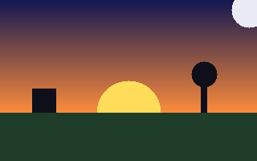
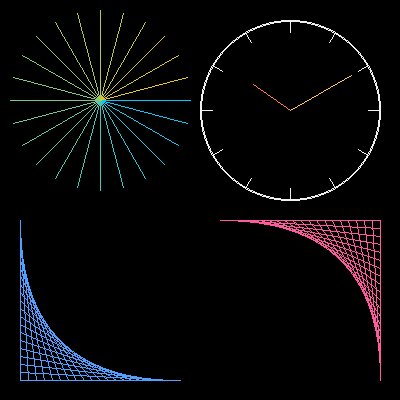
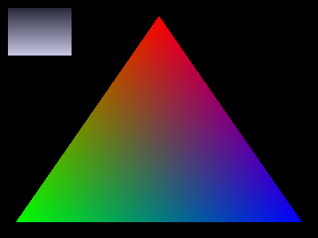
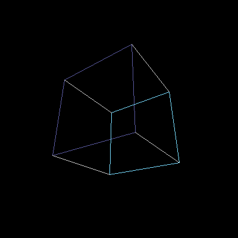
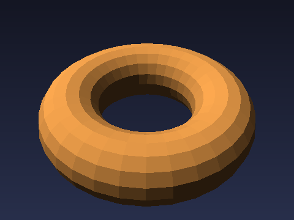
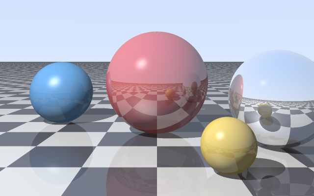

# Graphics Track — Build a Renderer from Scratch (C)

[Roadmap](../ROADMAP.md) · [Glossary](../GLOSSARY.md) · [Start: G1 — Canvas →](G1-canvas.md)

> Prerequisites: C chapters 00–05 (structs, `malloc`/`free`, text files from C 03 §8, bytes from C 05) and C 01 Subchapter G (PPM images). Time: about 40–60 hours for G1–G6.

Every game, film and 3D app ends the same way: a grid of pixels in memory, three bytes each. In this track you write the code that fills that grid yourself — no graphics library, no GPU — so you understand what the GPU later does for you.

You will build, in order:

| # | Chapter | You build | Picture |
|---|---------|-----------|---------|
| G1 | [Canvas and binary images](G1-canvas.md) | a pixel buffer, clipping, binary PPM files |  |
| G2 | [Lines and circles](G2-lines.md) | Bresenham lines, midpoint circles, a clock face |  |
| G3 | [Triangles](G3-triangles.md) | edge functions, filled triangles, color blending |  |
| G4 | [3D math and wireframes](G4-3d-wireframe.md) | vectors, matrices, perspective, a spinning cube |  |
| G5 | [Solid 3D: depth, light, models](G5-solid-3d.md) | depth buffer, back-face culling, lighting, an OBJ loader |  |
| G6 | [Ray tracing](G6-raytracer.md) | ray–sphere hits, shadows, reflections, anti-aliasing |  |

Every picture above was made by the reference solutions in [`solutions/c/graphics/`](../solutions/c/graphics/). Attempt each exercise first.

## How the track works

- **One growing program.** Each chapter adds to the code of the one before. Keep your own `canvas.c`/`canvas.h` from G1 and reuse it everywhere. (The reference solutions are single files so each one runs on its own.)
- **Output is always an image file.** Build, run, open the `.ppm`. G1 explains how to view it on each OS.
- **Check by looking, then by numbers.** A wrong sign in 3D math is obvious in the picture. Each chapter also gives numeric checks you can `assert`.
- Build with `-std=c17 -Wall -Wextra -g` while developing and add `-O2` for big renders. Link the math library with `-lm` from G2 on.

## Coming next (planned)

- **G7 — Real-time window**: show frames live with SDL2 and handle the keyboard.
- **G8 — Game engine milestone**: game loop, input, scenes, on top of your renderer.
- **G9 — Render server**: an HTTP service that renders a scene on request, using threads (C 10) and sockets (C 09).
- **GPU track (C++)**: OpenGL, then Vulkan, after the C++ bridge.

## Book guides and references (concept-only)

- **Computer Graphics from Scratch** (Gabriel Gambetta) — rasterizer and ray tracer at exactly this level; free online.
- **Ray Tracing in One Weekend** (Peter Shirley) — the classic short path-tracing series; free online.
- **Fundamentals of Computer Graphics** (Marschner & Shirley) — the textbook when you want the full math.
- [Scratchapixel](https://www.scratchapixel.com/) — free lessons on rasterization and ray tracing.
